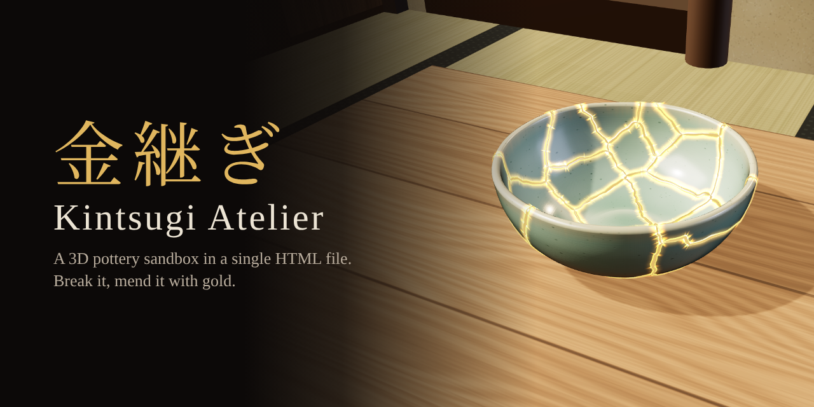
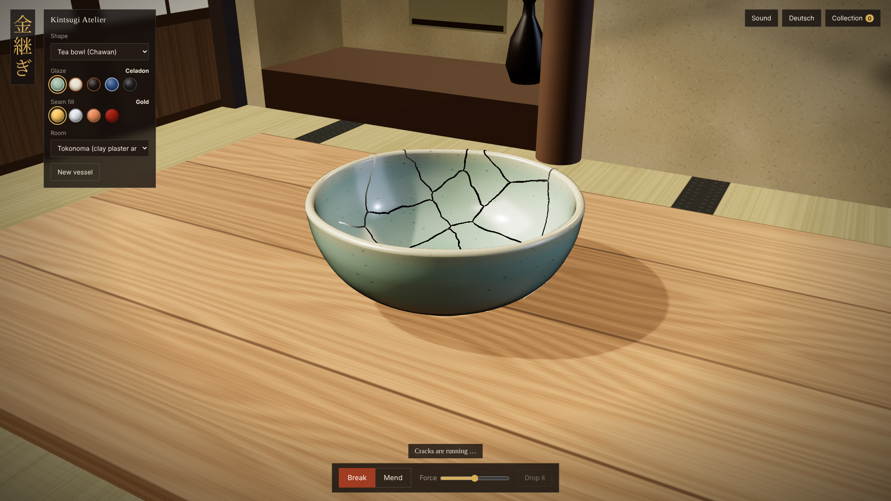
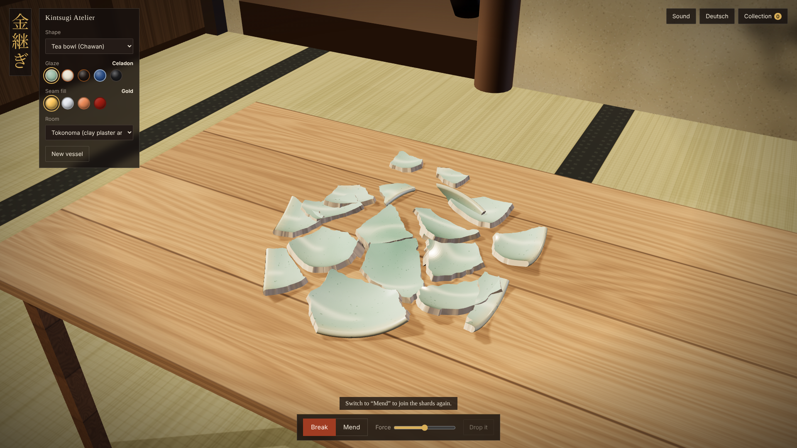
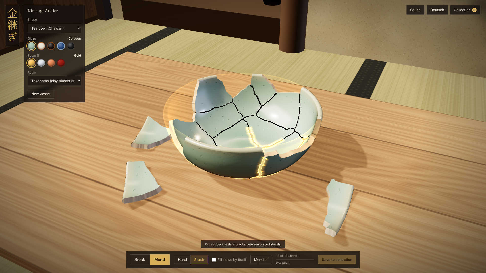
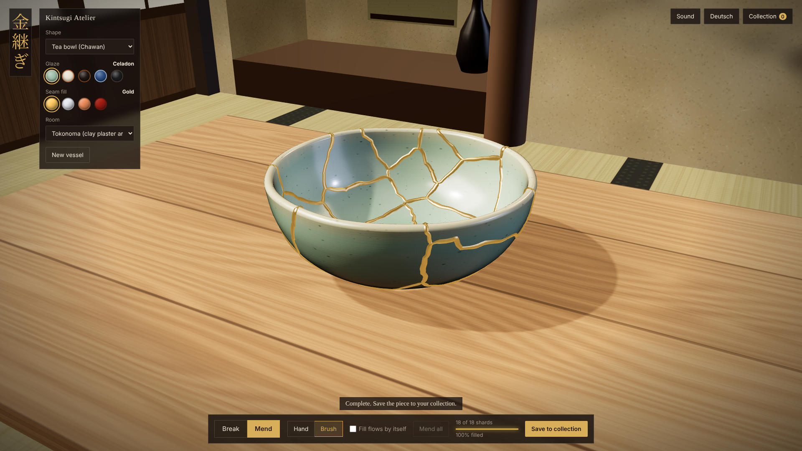
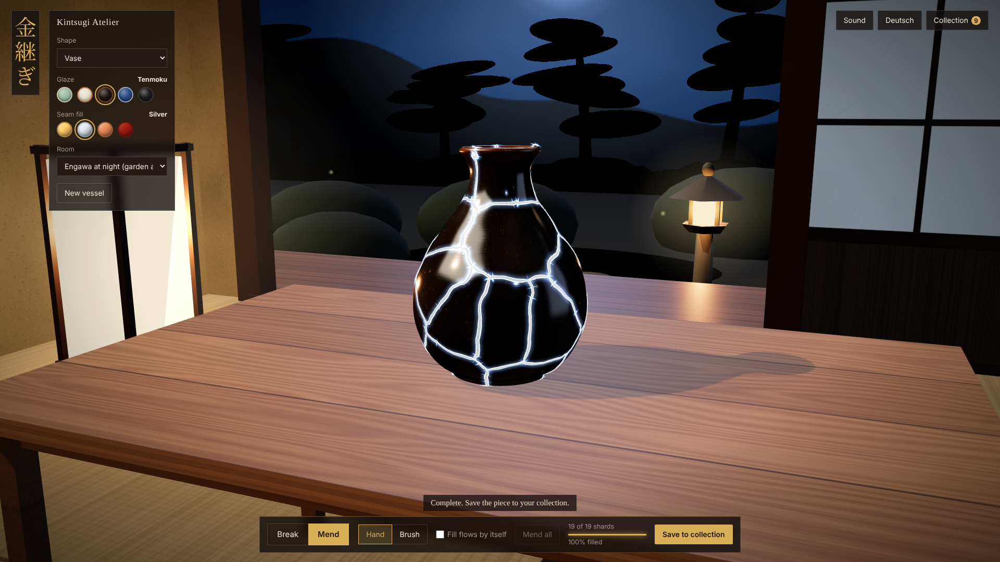
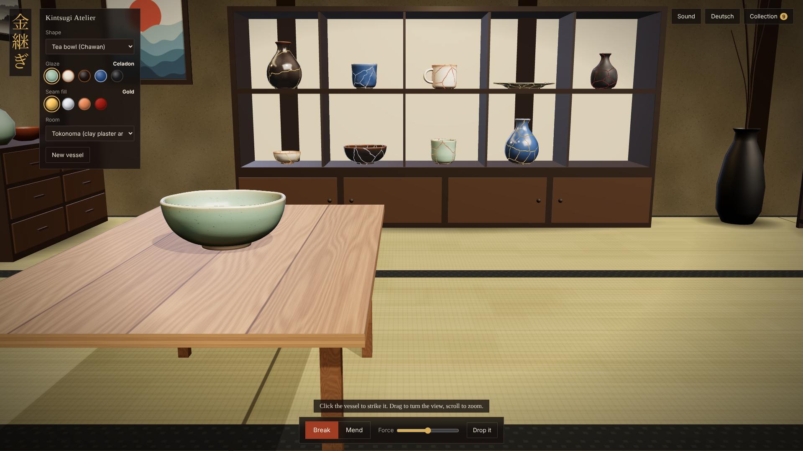

# 金継ぎ Kintsugi Atelier

A small 3D pottery sandbox that runs in the browser: break a ceramic vessel, put the shards back together and fill the seams with gold. Everything lives in **one self-contained HTML file** – no build step, no server, no external assets.



## Play

Open `Kintsugi-Atelier.html` in a current desktop browser (Chrome, Edge or Firefox). That is all – the file works straight from disk and makes no network requests.

## What you can do

- **Break** – click the vessel to strike it, or drop it onto the table. Cracks spread from the point of impact, then the vessel falls apart into Voronoi-style shards with rigid-body physics. The force slider controls how many shards you get (roughly 5 to 50).
- **Mend** – drag shards back into place or click one and it finds its own way. Apply the fill along the cracks with the brush, or let it flow by itself.
- **Choose materials** – seven shapes, five glazes and four seam fills (gold, silver, copper, red urushi lacquer).
- **Collect** – save finished pieces with a name, look at each one in a showcase view, pull its shards apart, export an image. The ten most recent pieces also stand in a cabinet on the studio wall.
- **Settle in** – three rooms (tokonoma, shoji wall, engawa at night), generated background music and sound effects with separate volume controls, English and German interface.

| | | |
|---|---|---|
|  |  |  |
|  |  |  |

## Controls

| Action | Mouse | Key |
|---|---|---|
| Turn the view | drag | |
| Zoom | scroll wheel | |
| Move the view | right-drag or Shift + drag | |
| Break mode / strike | click the vessel | `B` |
| Drop the vessel | | `F` |
| Mend mode | | `K` |
| Hand tool: place a shard | drag it, or click it | `H` |
| Brush tool: apply the fill | drag over the cracks | `P` |
| Mend all | | `A` |
| New vessel | | `N` |
| Open a piece from the wall cabinet | click it | |
| Leave the showcase view | | `Esc` |

Touch works for turning (one finger) and zooming (pinch); the interface is designed for desktop.

## How it is built

- **Rendering:** [three.js](https://threejs.org) r170, embedded in the file.
- **Geometry:** each vessel is a lathe shell generated from an outer profile, with wall thickness, a foot ring, an optional handle and small hand-made irregularities.
- **Fracture:** Voronoi-style partition of the shell. Mixed triangles are cut along the cell borders, so neighbouring shards share their cut points exactly and fit back together without gaps.
- **Physics:** a compact custom rigid-body solver. Shards collide with table and floor through hull points; between each other they are only pushed apart softly.
- **Seams:** raised ribbons along every fracture line with a per-point timestamp – a dark hairline before, glowing lacquer when applied, polished metal once set.
- **Textures, rooms, furniture, cursors:** generated at runtime on canvases or as inline SVG.
- **Audio:** Web Audio API only – ceramic clinks, cracking, brush strokes and an endless generated ambient track.
- **Storage:** the collection is kept in the browser's `localStorage` as a recipe (shape, glaze, fill, seeds, fracture parameters) and rebuilt from it. Export and import as JSON are built in.

## Extending

Shapes, glazes, seam fills, rooms and languages are plain data registries. Add entries in the marked section near the end of the script, or try them live in the browser console:

```js
Kintsugi.registerShape({
  id: 'soup-bowl',
  name: { en: 'Soup bowl', de: 'Suppenschale' },
  profile: [[0, 0], [0.5, 0], [0.9, 0.15], [1.15, 0.45], [1.2, 0.62]], // outer contour as [radius, height]
  thickness: 0.06,
  foot: { radius: 0.5, width: 0.1, height: 0.05 }
});

Kintsugi.registerGlaze({ id: 'oribe', name: 'Oribe green', base: '#2f6b4f', pool: '#17402e', brk: '#c2b280', speck: '#0e2a1e', clay: '#b9a58d' });

Kintsugi.registerFill({ id: 'platinum', name: 'Platinum', color: '#dfe3e6', metalness: 1, roughness: 0.2 });
```

`Kintsugi.registerRoom({ id, name, build(k) { … } })` adds a room; the built-in rooms in the script show how the small scene kit `k` is used. Interface texts live in the `I18N` table (English and German); the code comments are in German.

## Known limits

- Shard-to-shard collision is approximate, so shards can overlap slightly in a pile.
- The handle of the mug always breaks off as one piece.
- Walls use baked light; furniture casts only a soft contact shadow.
- The collection is stored per browser. Clearing site data removes it – use *Export* for a backup.

## Credits

- three.js – Copyright © 2010–2024 three.js authors, MIT License.
- All geometry, textures, images and sounds are generated procedurally by the game itself.

## License

Not chosen yet. Until a license file is added, all rights are reserved by the author.
